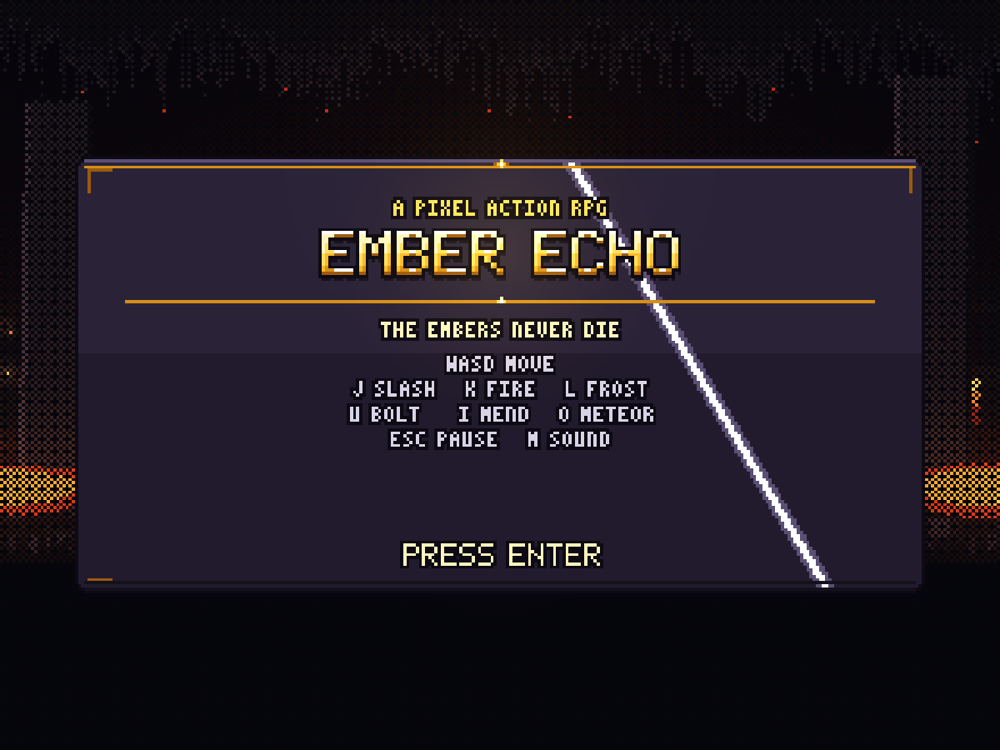
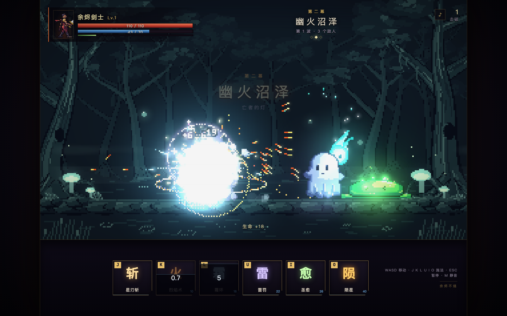

# 余烬回响 · Ember Echo

一个用 **pixelfx** 的像素素材与特效模块搭起来的动作 RPG Demo：七幕关卡、35 把武器、212 个技能、八种小怪与三阶段 Boss。打开游戏先进入可自由走动的 **营地场景**，向右可进入城镇；走入营地传送门后才打开整备页面，查看人物、更换装备和升级，再确认进入战斗。战斗画面和 UI 素材来自 pixelfx，菜单文字和触摸输入由 HTML 处理。





```
WASD      移动（八向，纵向有轻微纵深）
SPACE     快速移动（短距离位移）
Q / SHIFT 闪避（0.42 秒无敌窗口，带输入缓冲和冷却）
TAB       背包（战斗中更换武器与技能槽）
J         星刃斩（按住三段连斩，无消耗；闪避接斩强化）
K         烈焰术（火球，爆炸并灼烧）
L         霜环（身周冰环，冻结）
U         雷罚（落雷，眩晕；有落点预警）
I         圣愈（治疗 + 护盾）
O         陨星（三重陨石，大范围）
E         魂爆（可在背包装入任意技能槽）
Esc       暂停 / 继续
P         暂停 / 继续（战斗按钮也可点击）
M         静音
Enter     在营地传送门处打开整备 / 战斗结算后返回营地
1–7       整备页面内切换页签
Esc       整备页面返回营地场景
```

## 运行

需要 Node.js 18+。首次运行先打包一次（把 pixelfx 的素材、特效与像素 UI 模块打进单个 `game.js`）：

```bash
cd /Users/michiyang/Desktop/code/develop/game_dev/ember-echo
node build.mjs
node server.mjs
# 打开 http://127.0.0.1:8123/
```

`game.js` 已经随目录提供，所以也可以直接：

```bash
npm start           # 只起静态服务器
npm run dev         # esbuild --watch + 静态服务器
npm run build       # 重新打包
```

打包脚本会优先用本目录的 `node_modules/.bin/esbuild`，其次用同级 `../pixelfx/node_modules/.bin/esbuild`。

`game.js` 已经提交在仓库里，克隆后无需打包即可运行。只有改动 `src/` 后需要重新打包；
从零构建时把 pixelfx 检出到同级目录并安装它的依赖：

```bash
git clone https://github.com/hanhandi-git/pixelfx-extended.git ../pixelfx
cd ../pixelfx && npm ci && cd -
node build.mjs
```

## 内容

- **七幕长场景**：苔痕遗迹 → 幽火沼泽 → 熔岩深窟 → 极光隘口 → 晶脉空洞 → 墨影神龛 → 日灼圣殿；每幕是 480px 横向战场，镜头随主角推进，最后一幕有 Boss。
- **小怪**：苔泥、草蛇、沼蛙、夜蝠、鬼火、游魂、窥视者、焚颅。每种都有自己的像素循环、追击方式、攻击前摇与地面/连线预警。
- **Boss**：冥河守卫 · 阿刻戎。镰刀横扫、雷击落点、全屏雷环、召唤鬼火、三重陨石；66% / 33% 血量切换相位，并召唤增援。
- **营地**：启动和返回营地时直接显示像素场景，可以用 WASD 或触屏摇杆走动并前往城镇。走入营地传送门后打开整备页面，左侧常驻人物卡，右侧页签管理装备、技能和永久升级；点击「进入战斗 / 继续冒险」才出发，有存档时也可以选择「新的征程」。整备时角色停止移动，按 Esc 或点击「返回营地」可取消，离开再进入传送门即可重新整备。
- **成长**：击破获得经验，升级提升生命、法力与伤害；敌人掉落红心、法力药水、经验球，会自动吸附。击败敌人和通关会获得 **余烬**，可在营地的「升级」页永久提升体魄、灵脉、锋锐、疾行；死亡后余烬与强化等级都会保留，也可以一键重置并全额返还。
- **管理**：`TAB` 打开背包面板，可在 35 把武器/投掷装备和 212 个技能效果中选择，并把技能自由放进六个快捷槽。新增炎狱巨剑、冰魄光剑、幽影太刀、雷鸣钝剑、星辉短剑五把地下城剑系武器，每把都有独立的连段节奏、持械轮廓和命中特效。营地与战斗中的面板共用同一套界面，角色、装备、技能和语言选择会写入本地存档。
- **语言**：设置页支持中文（默认）、English、日本語，选择会保存在本机。
- **战斗手感**：按住三段连斩，支持 160ms 单次输入缓冲；默认武器使用拔刀横切 → 交叉双斩 → 全身回旋收尾，带短人物残像、刀光前后分层和脚下扬尘。镰刀、棍、刺剑、爪、重锤、太刀与圣剑使用不同的 pixelfx 近战动作。第三段扫开小群敌人，闪避接斩伤害 +15%，普攻可被闪避取消。轻斩、二连、重击的命中停顿与音效逐级加重，小怪受击会打断起手并沿受击方向后退，Boss 保留出招韧性。局部冲击弧、延迟血条与弹出数字突出接触，震屏和低透明度闪光保留战场可读性。详见 [战斗手感分析与调优指南](docs/COMBAT_FEEL.md)。
- **关卡流程**：每幕清场后会在长场景右侧打开传送门，走入传送门才会进入下一幕；最终关卡的传送门使用赤红色终焉配色。
- **UI**：战斗按钮、技能槽、装备卡片和背包钢框直接使用 pixelfx 的 Ember UI 素材；冷却遮罩、按下、高光和缺蓝状态由实际游戏状态驱动。HTML 菜单使用清晰的系统字体，并保留中文（默认）、English、日本語。武器图标使用各武器的造型，人物页显示游戏中的真实角色。
- **HUD 排布**：左上是头像与生命/法力，右下是两排技能节点。触屏时显示左下摇杆、右下快移/闪避、右上背包/暂停；前后三个技能槽的视觉上下排颠倒，槽位和键位仍对应。背包/暂停图标为 42px，点击区为 64px，相邻热区间隔 12px。
- **H5 触屏**：桌面端不绘制底部控制条；检测到触屏后显示 DOM 虚拟摇杆、技能按钮、快速移动、闪避、背包和暂停按钮。摇杆支持圆形死区、对角线归一化、多指同时操作，并处理松手、切后台和暂停复位。
- **声音**：全部由 WebAudio 现场合成，无音频文件。每个音效分层叠加瞬态、主体与尾音，共用一条卷积混响与限幅器；相同音效同帧会节流，并按世界坐标做立体声定位。原创的 16-bit 风格背景音乐会随营地、七幕关卡和 Boss 战切换（每幕转调，Boss 战加快加重），环境低音也会跟着改变调式与强弱。首次点击或按键后启动；设置页可分别调整总音量、音效、背景音乐与环境音量，`M` 键静音，设置保存在本机。

## 武器美术

所有装备使用共享的四倍原生采样像素源，手持、图标与放置展示保持一致。pixelfx 的 41 套模型均已重绘，涵盖剑、大剑、太刀、锤、矛、弓枪及全部八种投掷装备；刃面、雕纹、宝石、握柄、法器与机械结构按主题分别设计。投掷后的苦无、炸弹、回旋镖、飞剑、铜铃、符纸、飞针和绫带同样采用新图形。

pixelfx Gallery 的「武器 / 投掷物」内容标签可集中浏览模型和动作，并与主题、分类、来源和搜索组合使用：`gallery/?type=equipment&lang=zh`。

## 素材来源

游戏本身只做三件事：摆放、读时间、判定命中。画面来自同级 pixelfx 仓库的现成模块：

- 地图：`world/mossy-ruins`、`world/wisp-marsh`、`world/ember-depths`
- 怪物：`critters/slime`、`snake`、`frog`、`bat`、`wisp`、`ghost`、`eyeball`、`flying-skull`
- 技能：`melee/sword-slash`、`double-slash`、`heavy-cleave`、`fire/fireball`、`meteor`、`ice/frost-nova`、`lightning/lightning-strike`、`holy/heal-aoe`、`divine-shield`、`blessing`
- 反馈：`impacts/hit-spark`、`crit-hit`、`explosions/small-explosion`、`spawn/poof`、`spawn/shatter-death`、`spawn/spawn-portal`、`pickups/*`、`status/frozen`、`burning`、`stunned`、`ui/level-up`、`ui/combo-counter`、`arcane/rune-circle`；关卡传送门使用游戏内的 `stage-portal` 动态特效。
- UI：`ui/touch-action-button`、`ui/skill-node`、`ui/loadout-card`、`ui/loadout-panel`、`ui/panel`、`ui/status-bar`、`ui/skill-slot`、`ui/dialog`、`ui/banner`、`ui/toast`，以及复用的 `ui/quest-complete`、`ui/combo-counter`、`ui/level-up`
- 角色：`src/core/characters.js` 的 `ember-duelist`（主角）与 `styx-warden`（Boss），由 `src/core/rig.js` 的骨骼/姿势系统绘制。

## 代码结构

```
index.html          320×180 战斗画布与菜单、触摸输入层
styles.css          16:9 战斗画布、安全区与响应式菜单
game.js             由 build.mjs 生成的单文件产物（可直接部署）
build.mjs           esbuild 打包脚本
server.mjs          零依赖静态服务器
src/main.js         启动、键盘/点击输入、主循环
src/game/index.js   组合各 system 的 Game 门面
src/game/core.js    会话状态、关卡启动、指针路由（含营地状态）
src/game/systems/   循环、关卡流程、战斗、渲染、存档、自动战斗
src/hero.js         主角属性、移动、骨骼动画、受伤/升级、余烬强化、头像
src/upgrades.js     余烬强化数据与费用计算
src/settings-ui.js  营地/背包共用的 HTML 管理面板
src/enemies.js      小怪 AI / Boss 三阶段 AI / 状态与血条
src/skills.js       六个技能的施法与命中判定
src/melee-arts.js   武器动作分组、pixelfx 姿态与特效的命中帧重映射
src/fx/ember-draw.js 新增的宽刃拔刀效果（复用 pixelfx 武器特效构造器）
src/fx/melee-swing.js 普攻特效演出、短尾迹与扬尘
src/data.js         素材导入、敌人与关卡数据、技能元数据
src/ui-art.js       pixelfx 素材到 DOM 的绘制与有界缓存
src/ui.js           在 canvas 内绘制 HUD、技能栏、暂停/失败/胜利、横幅与 Toast
src/audio.js        WebAudio 分层合成、混音总线、混响与环境音
src/music.js        原创 16-bit 风格 BGM：营地/关卡/Boss 主题与预排程音序器
```

## 设计说明

- 画布固定 320×180，整体用 `image-rendering: pixelated` 放大；营地与城镇使用异步加载的预渲染地图，走入营地传送门后管理面板浮在场景之上。
- 所有技能都是“先演后判”：火球有飞行时间，雷罚有 0.95s 落点预警，陨石有 1.15s 圈，Boss 大招有 0.7–1.3s 前摇。玩家可以靠走位躲开。
- 敌人攻击有地面圆环 / 目标连线提示；Boss 阶段切换会改变攻击池并召唤增援。
- 命中停顿、震屏、闪光和伤害数字都走同一套轻量系统；普攻与普通特效在命中停顿时冻结，局部冲击环和震屏按实时时间衰减。输入缓冲保留，闪避可立即解除停顿。重击短暂压低背景音乐与环境声，再平滑恢复；音量设置独立保留。
- 音效走独立的总线：音效/背景音乐/环境三路汇入压缩限幅器，再叠一条程序生成的卷积混响；高频命中音会做 35–60ms 的同名节流和轻微变调，避免多段连击叠成噪音。远处敌人的施法、死亡与 Boss 招式按屏幕横向位置声像偏移并轻微衰减。
- 背景音乐是项目原创的 16-bit 风格芯片音乐（不使用商业 RPG 曲目），由 [src/music.js](src/music.js) 的预排程音序器实时演奏：营地是 84 BPM 的竖琴与长音垫，关卡是 132 BPM 的八分音符驱动，Boss 战是 150 BPM 的十六分音符低音与和声小调旋律；八小节循环，每幕按五度圈附近转调，切换场景时淡出淡入。
- UI 只有一个视觉语言：沿用 Quest complete / Achievement 的深色圆角面板、金色内框、5×7 像素字和分段条；新 UI 效果都放在 `pixelfx/src/fx/ui/`，和原有 UI 特效同一目录、同一套 `_lib` 面板/像素字。

## 许可

本 Demo 的代码以 MIT 许可发布；其中打包的 pixelfx 素材、渲染器、特效代码与像素 UI 效果同样为 MIT，详见
[LICENSE](LICENSE) 与 [NOTICE.md](NOTICE.md)。

## 已知边界

- 这是一个单机 Demo，没有技能树和联网；当前版本有本地存档（装备、技能槽、收藏、余烬强化与进行中的远征）、营地管理、武器装备、技能槽替换、快速移动与闪避。
- 主要按桌面键盘设计；营地中走入传送门打开整备，点击确认按钮出发，战斗结算后 Enter 回到可走动的营地场景。
- 打包依赖同级 `pixelfx` 仓库（素材、特效与 `src/fx/ui/` 像素 UI 效果）；`game.js` 已是自包含产物，部署时只需要 `index.html`、`styles.css`、`game.js`。

## 新 UI 的本地验证

`http://127.0.0.1:8123/?controls=touch` 可在桌面预览触屏布局。真实手机会自动识别触屏，无需参数。按钮图案、选中态和半透明冷却层来自 pixelfx 模块，装饰 Canvas 不接收指针事件，热区由真实按钮处理。

界面素材随 `npm run build` 打包进 `game.js`，运行时不依赖 pixelfx Gallery 或 `records/` 图集，也无需额外复制资源到 Docker。只有可见战斗控件按 10 FPS 更新装饰，背包静态图标按配置缓存；菜单滚动、装备状态和键盘焦点独立处理。


人物现已分为剑士与法师，各自使用独立技能族、技能槽与造型配置；新增五套 DNF 本地参考像素造型。操作、导入与素材来源见 [角色说明](docs/HEROES.md)。
